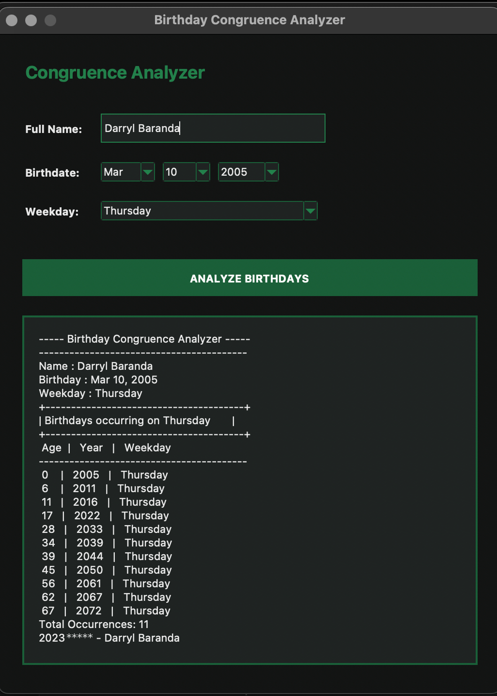

# Birthday Congruence Analyzer

A desktop app that finds every year your birthday lands on the same weekday you were born, using **modular arithmetic (congruence mod 7)** instead of a calendar library.



## How it works

A standard year has 365 days, and `365 = 7(52) + 1`, so `365 ≡ 1 (mod 7)`: your birthday moves forward **one** weekday each year.
A leap year has 366 days, and `366 = 7(52) + 2`, so `366 ≡ 2 (mod 7)`: your birthday moves forward **two** weekdays.

With the birth weekday as day 0, the weekday at age *n* is:

```
Wₙ ≡ Wₙ₋₁ + d  (mod 7),   where d = 1 for a standard year, 2 for a leap year
```

The app applies this from age 0 to 72 and lists every age where `Wₙ ≡ W₀ (mod 7)`.

**Leap year edge case:** whether a Feb 29 falls between two birthdays depends on the birth month. For birthdays in **January or February**, the leap day that matters is in the *current* year. For birthdays from **March onward**, it's in the *next* year. The code handles both cases.

Leap years follow the Gregorian rule: divisible by 4, except century years, which must be divisible by 400.

## Verification

I cross-checked the output against Python's `datetime` calendar. For March 10, 2005 (a Thursday), both give the same 11 matching ages:

```
0, 6, 11, 17, 28, 34, 39, 45, 56, 62, 67
```

## Features

- Dark-themed Tkinter GUI with dropdowns for month, day, year and weekday
- Input validation: rejects missing names and impossible dates (e.g. Feb 30)
- Formatted results table with a total count

## Run it

Requires Python 3 (Tkinter comes with most installs).

```bash
python birthday_congruence_analyzer.py
```

## Project files

| File | Contents |
|---|---|
| `birthday_congruence_analyzer.py` | The GUI application |
| `docs/screenshot.png` | Sample output |

---
Number Theory course project by Darryl Baranda.
